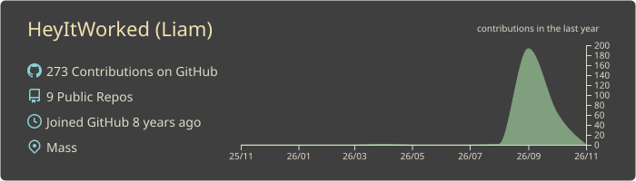
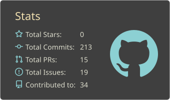
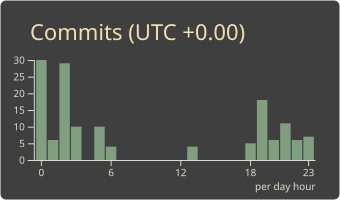
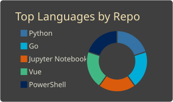
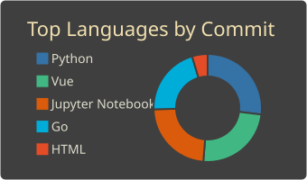

<picture>
  <source media="(prefers-color-scheme: dark)" srcset="assets/header-dark.svg">
  
</picture>

I'm Liam, based in Massachusetts. I work on healthcare software (FHIR and HL7 interfaces, EMRs, medical imaging) and contribute fixes to the open-source projects behind it, each with a test someone else can run.

  <a href="https://liamnguyenn.com">Website</a> &nbsp; / &nbsp;
  <a href="https://liamnguyenn.com/portfolio/">Portfolio</a> &nbsp; / &nbsp;
  <a href="https://liamnguyenn.com/contact/">Contact</a>

## Featured: Health IT Semester

<a href="https://heyitworked.github.io/health-it-semester/">
  <picture>
    <source media="(prefers-color-scheme: dark)" srcset="https://raw.githubusercontent.com/HeyItWorked/health-it-semester/main/.github/assets/preview-dark.png">
    
  </picture>
</a>

**[Health IT Semester](https://heyitworked.github.io/health-it-semester/)** is my free, seven-week course for new CS grads heading into healthcare IT in the US and Canada. It covers HL7 v2, FHIR, clinical data, privacy and shipping through 100 terminal sessions run against a real lab, using synthetic patients only.

  <a href="https://heyitworked.github.io/health-it-semester/"><b>Start the course</b></a> &nbsp; / &nbsp;
  <a href="https://github.com/HeyItWorked/health-it-semester">Repository</a> &nbsp; / &nbsp;
  <a href="https://github.com/HeyItWorked/health-it-semester/releases/tag/v1.0.0">v1.0.0 release</a>

## Merged upstream

- **[Nocturne](https://github.com/nightscout/nocturne/pull/2267)** · diabetes management platform, C#: made the v1 `/times/echo` endpoint use the same query parsing as `/times`, with regression tests for repeated parameters and other edge cases. [More merged PRs](https://liamnguyenn.com/portfolio/nocturne/) cover API capability reporting and shared test setup.
- **[fo-dicom](https://github.com/fo-dicom/fo-dicom/pull/2197)** · DICOM for .NET: fixed how `JsonDicomConverter` serializes empty single-valued text elements (ST, LT, UT), reported in [#2162](https://github.com/fo-dicom/fo-dicom/issues/2162).
- **[CARLOS EMR](https://github.com/carlos-emr/carlos/pull/5123)** · open-source EMR for Canadian healthcare: corrected a JavaScript name error in the Mental Health Referral and Assessment forms, and [stopped a missing-stylesheet request](https://github.com/carlos-emr/carlos/pull/5124) in the Position Hazard form. Browser checks cover both.
- **[VetLog](https://github.com/josdem/py-vetlog-calendar/pull/150)** · veterinary reminder scheduler, Python: pets that already have medical logs no longer appear on the missing-log reminder list. The test covers a household where only one pet needs a reminder.

## Things I build

- **[ContextPack](https://github.com/HeyItWorked/ContextPack)** · Python: packs project files into a fixed input limit and reports what it left out.
- **[RiverRoot](https://github.com/HeyItWorked/RiverRoot)** · Go: a small self-hosted CI server that runs pipeline steps on the host or in containers.
- **[MedCVE](https://github.com/HeyItWorked/MedCVE)** · Python and pandas: explores healthcare-tagged CVE records in a static dashboard.

## GitHub activity

More activity cards

 

Cards show the latest public-activity snapshot from <a href="https://github.com/vn7n24fzkq/github-profile-summary-cards">Summary Cards</a>. Commit times are in UTC, not working hours, and the language mix isn't a measure of skill.
