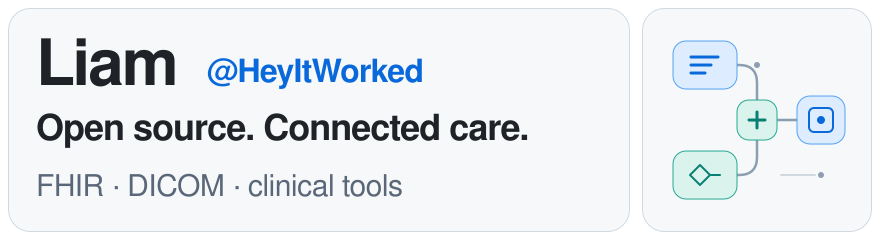
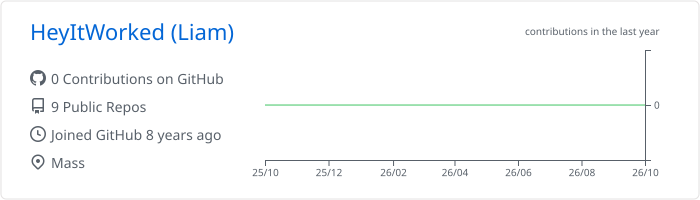
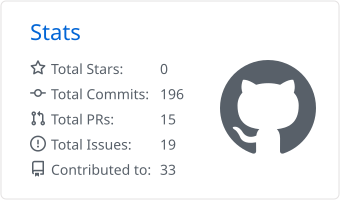
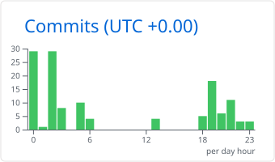
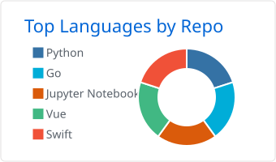
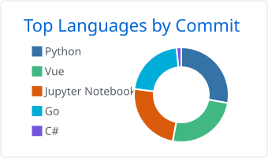

<picture>
  <source media="(prefers-color-scheme: dark)" srcset="assets/header-dark.svg">
  
</picture>

  <a href="https://liamnguyenn.com">Website</a> &nbsp; / &nbsp;
  <a href="#by-the-numbers">By the numbers</a> &nbsp; / &nbsp;
  <a href="#on-my-workbench">On my workbench</a>

## By the numbers

<picture>
  <source media="(prefers-color-scheme: dark)" srcset="profile-summary-card-output/github_dark/0-profile-details.svg">
  
</picture>

<picture>
  <source media="(prefers-color-scheme: dark)" srcset="profile-summary-card-output/github_dark/3-stats.svg">
  
</picture>
<picture>
  <source media="(prefers-color-scheme: dark)" srcset="profile-summary-card-output/github_dark/4-productive-time.svg">
  
</picture>

Language breakdown · repositories and commits

 
<picture>
  <source media="(prefers-color-scheme: dark)" srcset="profile-summary-card-output/github_dark/1-repos-per-language.svg">
  
</picture>
<picture>
  <source media="(prefers-color-scheme: dark)" srcset="profile-summary-card-output/github_dark/2-most-commit-language.svg">
  
</picture>

Updated daily with <a href="https://github.com/vn7n24fzkq/github-profile-summary-cards">Summary Cards</a> · Public-data totals may differ from GitHub's contribution graph · Commit times in UTC, not coding hours · Language mix, not proficiency.

## On my workbench

A guide to my pinned repositories: interoperability, clinical software, and the tools around them. Forks and upstream projects are labeled below.

<table width="100%">
<tr>
<td width="50%" valign="top">
<strong>01 / Interoperability</strong> 
<a href="https://github.com/HeyItWorked/firely-net-sdk"><strong>Firely .NET SDK</strong></a> 
HL7 FHIR tooling for .NET. 
C# · Fork of FirelyTeam/firely-net-sdk
</td>
<td width="50%" valign="top">
<strong>02 / Medical imaging</strong> 
<a href="https://github.com/HeyItWorked/fo-dicom"><strong>Fellow Oak DICOM</strong></a> 
DICOM across the .NET ecosystem. 
C# · Fork of fo-dicom/fo-dicom
</td>
</tr>
<tr>
<td valign="top">
<strong>03 / Diabetes management</strong> 
<a href="https://github.com/HeyItWorked/nocturne"><strong>Nocturne</strong></a> 
An open-source diabetes management platform. 
C# · Fork of nightscout/nocturne
</td>
<td valign="top">
<strong>04 / Electronic medical records</strong> 
<a href="https://github.com/carlos-emr/carlos"><strong>CARLOS EMR</strong></a> 
Open-source EMR for Canadian healthcare. 
Java · Upstream project
</td>
</tr>
<tr>
<td valign="top">
<strong>05 / Modernization</strong> 
<a href="https://github.com/HeyItWorked/openclinic"><strong>OpenClinic</strong></a> 
PHP 8.4 compatibility, one improvement at a time. 
PHP · Fork of jact/openclinic
</td>
<td valign="top">
<strong>06 / Scheduling</strong> 
<a href="https://github.com/HeyItWorked/py-vetlog-calendar"><strong>Vetlog Calendar</strong></a> 
Event scheduling for the Vetlog database. 
Python · Fork of josdem/py-vetlog-calendar
</td>
</tr>
</table>

Design: original bento-style header and project layout, inspired by <a href="https://openreadme.vercel.app/">OpenReadme</a>. Metrics are generated into this repository; no third-party image server is needed when viewing this profile.
